<p align="center">
  <a href="https://quyenchau.pages.dev"></a>
</p>

<p align="center">
  <a href="https://quyenchau.pages.dev"></a>
  <a href="https://www.linkedin.com/in/quy%E1%BB%81n-ch%C3%A2u-7b1331246/"></a>
  <a href="mailto:ctuanquyen97@gmail.com"></a>
</p>

## About

Full-stack engineer in **Ho Chi Minh City** with **7+ years** across Java and Kotlin backends, native and Flutter mobile, and NestJS microservices. I've shipped POS hardware integrations, PCI-scoped payment services, real-time tracking and event-driven pipelines.

I like owning a codebase end to end: architecture, releases, crash triage and code review.

- **Open to:** full-stack roles, especially ones that cross backend and mobile
- **Now building:** a POS terminal app, an on-device card tokenization service and a real-time tour booking platform
- **After hours:** I build AI agent tooling for Claude Code

## What I build

<table>
  <tr>
    <td width="50%" valign="top">
      <h3>Payments and POS</h3>
      Android/iOS POS apps across PAX, Clover and BLE card readers. An embedded Ktor service that hands third-party POS software card <b>tokens</b> instead of raw card data. Stripe and VNPay with webhooks.
    </td>
    <td width="50%" valign="top">
      <h3>Real-time and maps</h3>
      Live tour tracking and turn-by-turn navigation that recover from GPS and network loss. Horizontally scalable location service on Socket.IO with the Redis adapter.
    </td>
  </tr>
  <tr>
    <td width="50%" valign="top">
      <h3>Event-driven backends</h3>
      Java Spring and Quarkus services on Kafka, gRPC and MQTT for multi-tenant network platforms with thousands of devices. High-load time series on TimescaleDB.
    </td>
    <td width="50%" valign="top">
      <h3>Mobile apps</h3>
      Native Kotlin and Swift, Flutter with BLoC and Clean Architecture, React Native. Published to Google Play and the App Store, kept stable through Crashlytics.
    </td>
  </tr>
</table>

## Tech stack

<p>
  <b>Backend</b><br>
  
</p>
<p>
  <b>Mobile</b><br>
  
</p>
<p>
  <b>Web and data</b><br>
  
</p>
<p>
  <b>DevOps</b><br>
  
</p>

Also: Quarkus · Ktor · gRPC · MQTT · BullMQ · Socket.IO · TimescaleDB · Helm · SonarQube · PAX POSLink · Clover SDK · Google ML Kit

## GitHub activity

<!-- STATS:START (generated by .github/scripts/stats.mjs, do not edit) -->
<table>
  <tr>
    <td align="center" width="25%"><h3>11</h3><sub>Public repositories</sub></td>
    <td align="center" width="25%"><h3>72</h3><sub>Public commits, all time</sub></td>
    <td align="center" width="25%"><h3>39</h3><sub>Public commits in 2026</sub></td>
    <td align="center" width="25%"><h3>2019</h3><sub>On GitHub since</sub></td>
  </tr>
  <tr>
    <td colspan="4">
      <b>Top languages</b> <sub>(share of code across public repositories)</sub><br><br>
      
    </td>
  </tr>
</table>

<sub>Live counters from the GitHub API, refreshed hourly. Last updated 2026-11-18 01:18 (UTC+7), latest push 2026-11-17. Most of my professional work lives in private client repositories and is not counted here.</sub>
<!-- STATS:END -->

## Featured projects

| Project | What it is | Stack |
|---|---|---|
| [**technical-teams**](https://github.com/Tuan-Quyen/technical-teams) | Claude Code plugin that runs a virtual software team: a tech-lead agent routes each request through 12 specialist agents and 7 delivery pipelines, with resumable state | JavaScript · AI agents |
| [**GiaoLuuTiengAnh**](https://github.com/Tuan-Quyen/GiaoLuuTiengAnh) | Multiplayer 3D study room for TOEIC: shared desks, proximity voice chat, timed exams and leaderboards | TypeScript · Three.js · Socket.IO |
| [**qcsocial**](https://github.com/Tuan-Quyen/qcsocial) | Real-time chat rooms over WebSocket with a reactive Quarkus backend on MongoDB and a bilingual Flutter client | Java · Quarkus · Flutter |

## Career at a glance

```text
2026  ●  Tour booking platform · card tokenization bridge · benefits member app
2025  ●  Healthcare benefits POS terminal (Android + iOS, PAX / Clover / BLE)
2024  ●  Driving lesson marketplace (Kotlin, Swift, Flutter, NestJS microservices)
2023  ●  Cloud network management platform (Spring, gRPC, Kafka, Android)
2022  ●  Asset tracking platform, team lead of 4 (Spring, Kafka, React Native)
2021  ●  Wi-Fi QoE analytics (Quarkus microservices, TimescaleDB)
2020  ●  Smart home IoT control (Kotlin, MQTT, Quarkus)
2019  ○  Started as a mobile engineer
```
